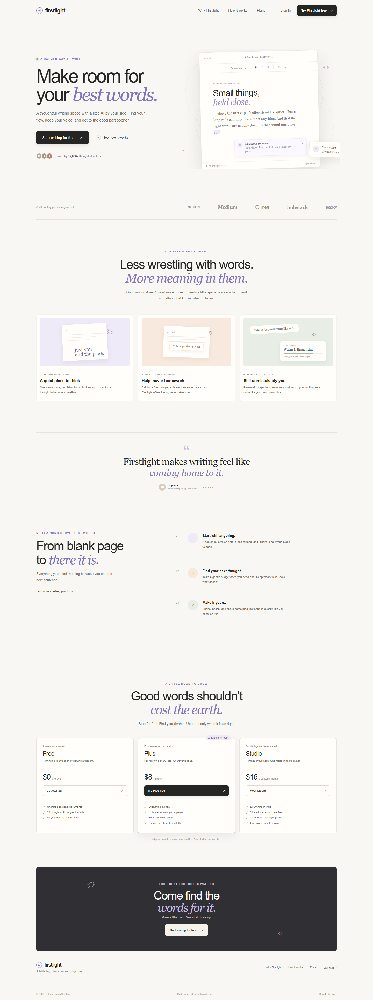

# Firstlight — Make room for your best words

Firstlight is a fictional AI writing companion presented as a responsive, editorial-style landing page. The visual direction pairs a warm paper background and muted lavender accents with a sunrise-and-diamond motif. The page uses plain HTML, CSS, and JavaScript—no framework, build step, or package installation is required.



## What’s on the page

1. **Hero and editor preview** — introduction, calls to action, and a CSS-built writing workspace.
2. **Brand strip** — a visual row of publication and tool wordmarks.
3. **Features** — three cards for distraction-free writing, optional AI suggestions, and preserving a personal voice.
4. **Testimonial** — an editorial quote between the product features and workflow.
5. **How it works** — a short, three-step writing flow.
6. **Plans** — Free, Plus, and Studio sample pricing cards.
7. **Closing call to action and footer** — final prompt, navigation links, and a year that updates automatically.

## Motion and interaction

- The mobile navigation opens from the menu button and closes after choosing a link or pressing Escape.
- Sections reveal gently as they enter the viewport.
- The editor preview has a slow float and a blinking text cursor; decorative accents use restrained motion.
- Buttons and feature cards have subtle hover feedback.
- When `prefers-reduced-motion` is enabled, animation and smooth scrolling are minimized, and content remains visible.
- Decorative artwork and the editor preview are built from HTML and CSS; no image library is needed.

## Run locally

Open `index.html` directly in a modern browser, or start Python’s built-in static server from the project directory:

```powershell
python -m http.server 8000
```

Open [http://localhost:8000](http://localhost:8000). Stop the server with `Ctrl+C`.

There are no dependencies to install. The page requests DM Sans and Newsreader from Google Fonts; system font stacks are used if the request is unavailable.

## Project files

| File | Purpose |
| --- | --- |
| `index.html` | Semantic page structure, copy, navigation, product preview, and pricing |
| `styles.css` | Color tokens, typography, components, responsive layouts, and motion |
| `script.js` | Mobile menu, Escape-key behavior, scroll reveals, and current footer year |
| `favicon.svg` | Firstlight sunrise icon |
| `screenshot.png` | Full-page desktop preview embedded above |

## Customize

- **Brand name and page copy:** update the title, metadata, labels, and section content in `index.html`.
- **Colors and typography:** edit the custom properties at the top of `styles.css`; the font links and fallback stacks are in `index.html` and `styles.css`.
- **Layout and breakpoints:** adjust the responsive rules near the bottom of `styles.css`.
- **Navigation and motion:** update the menu and reveal behavior in `script.js`; keep the reduced-motion rules in `styles.css` aligned with any new effects.
- **Contact links:** replace `hello@firstlight.example` with a real address or signup flow.
- **Demo content:** replace the sample audience count, wordmarks, testimonial, and pricing details before using the page as a real product site.
- **Screenshot:** recapture `screenshot.png` after visual changes so the README preview stays current.

## Accessibility and compatibility

The page uses semantic landmarks, heading structure, descriptive navigation labels, and an accessible expanded state for the mobile menu. Core content is visible without JavaScript; JavaScript only enhances the scroll reveals and navigation behavior. Responsive layouts are provided for desktop, tablet, and mobile viewports. The site targets current versions of Chrome, Edge, Firefox, and Safari.
